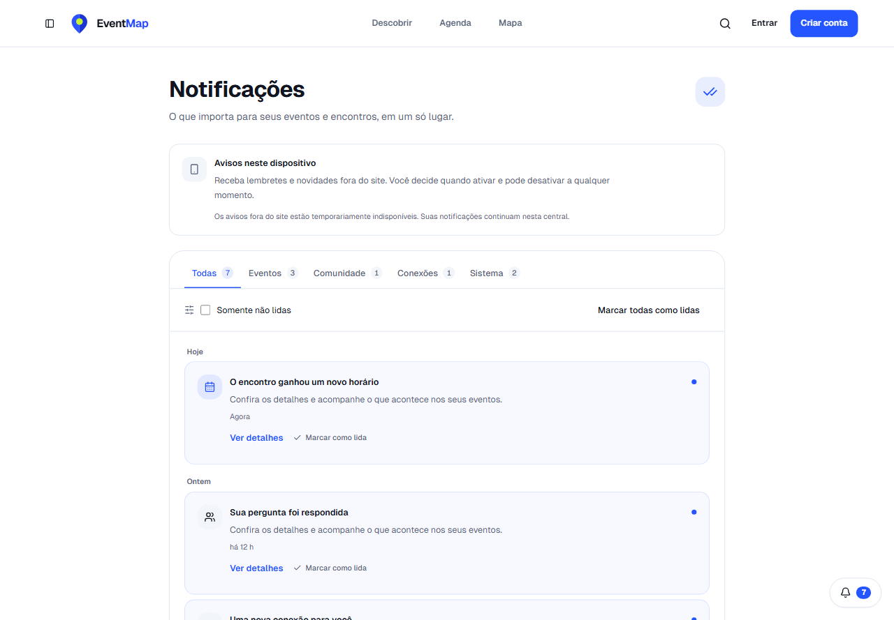
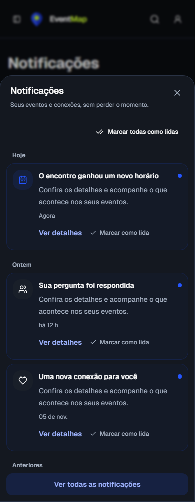
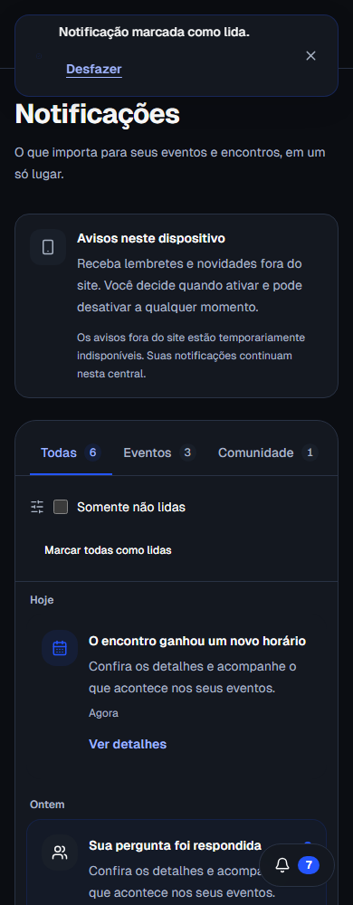
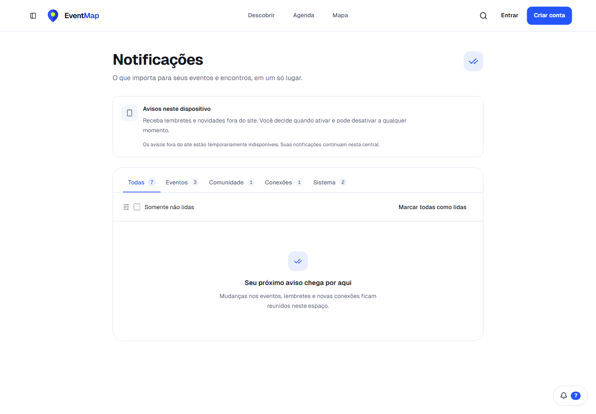

# Evidências de notificações premium

Capturas locais dos componentes reais da página e do sino, usando ações e sessão simuladas com dados fictícios. Não são capturas de produção nem comprovam entrega autenticada pelo Socket.IO.

As combinações 1440/390 e light/dark têm page (lista carregada e categorias), panel (diálogo aberto), empty (estado vazio) e undo (toast com Desfazer). Desktop foi rasterizado em 1280 px; mobile em 390 px. O fluxo de leitura e Desfazer foi acionado no Chromium. Nenhum pageerror ocorreu nas quatro combinações.

Limitações: harness local usa Next.js sem servidor Socket.IO e produz requisições de polling 404 do provider global; portanto não representa console de produção sem erros. CSP Report-Only não é emitida no desenvolvimento. Home/colisão de todos os controles fixos, banner recebido por socket, Lighthouse e entrega CDP de push ainda não foram validados nesta rodada.

`verify-notification-services.cjs` executa os seis serviços reais com persistência transacional em memória, sem mocks da criação/validação de notificações: inscrição, check-in, edição, denúncia, conexão e convite. Os cenários usam nome legado longo e vazio. Inscrição/check-in não criam notificação por si; o teste confirma que concluem e que os outros fluxos gravam notificações válidas. Não comprova concorrência/rollback no PostgreSQL real. Não foram alterados dados de produção.
