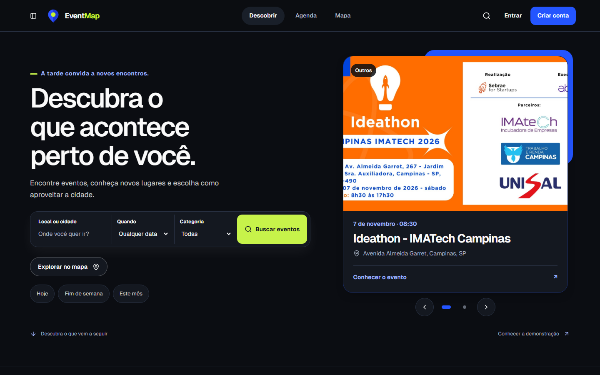
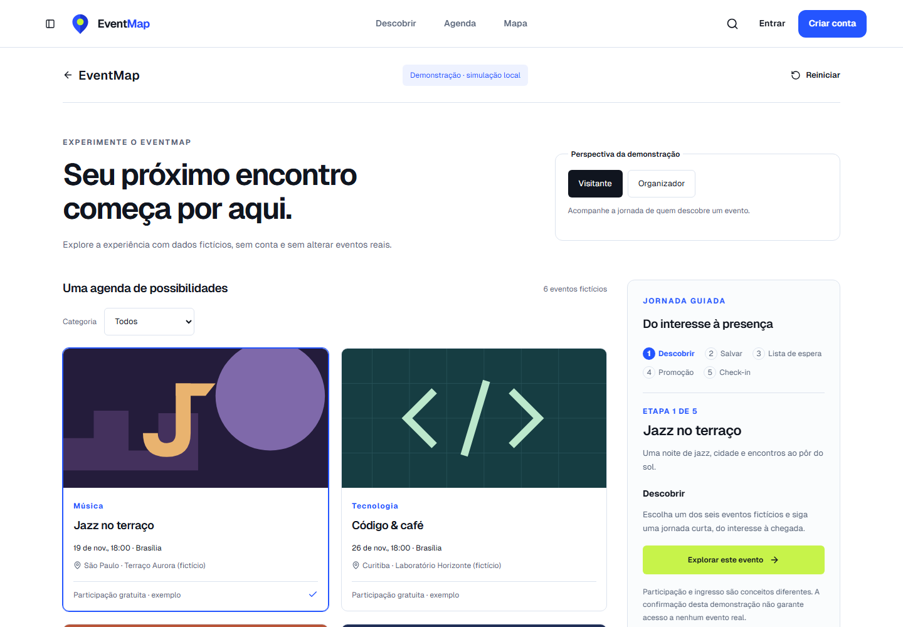
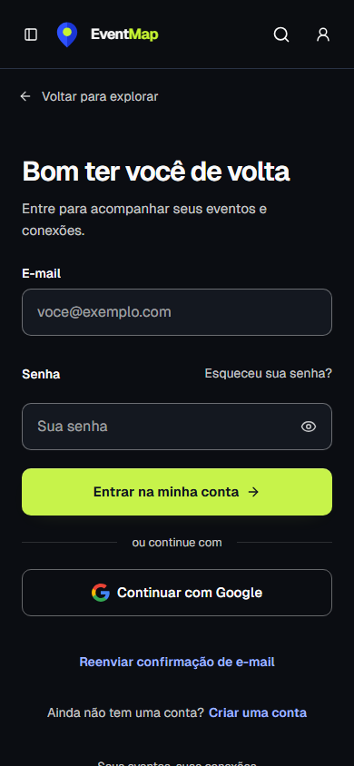
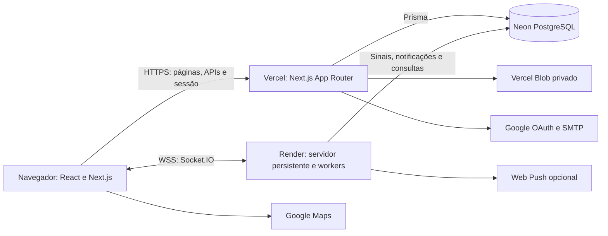

# EventMap

**Descubra eventos, encontre pessoas e acompanhe sua próxima experiência.**

Aplicação full stack para descoberta de eventos por mapa e agenda, organização de inscrições e colaboração em tempo real. Interface responsiva com temas claro e escuro, azul cobalto e verde-lima.

[Explorar o site](https://events-project-lake.vercel.app/) · [Experimentar sem conta](https://events-project-lake.vercel.app/demonstracao) · [Código do site](Events-Project/) · [Auditoria](AUDITORIA.md)



## O que o projeto resolve

O EventMap reúne descoberta, participação e organização em uma mesma aplicação: visitantes encontram experiências próximas; participantes acompanham inscrições e conversas; organizadores gerenciam eventos e presença; administradores revisam publicações e denúncias.

| Jornada | Recursos implementados |
| --- | --- |
| Descobrir | Mapa, agenda, filtros por categoria, período, preço e localização; páginas compartilháveis de eventos e promotores |
| Participar | Favoritos, inscrição, lista de espera, calendário ICS, lembretes e check-in por QR |
| Conectar | Chat por evento, salas de amigos, comunidade, notificações e conexões opcionais com matches privados |
| Organizar | Rascunhos, edição, recorrência, inscrições, check-in e indicadores de interesse |
| Administrar | Revisão de eventos, denúncias e importação de fontes públicas com aprovação individual antes de publicar |

## Veja em funcionamento

A [demonstração guiada](https://events-project-lake.vercel.app/demonstracao) usa eventos fictícios e não exige cadastro:

1. Escolha a perspectiva de visitante ou organizador.
2. Filtre por categoria e selecione um evento.
3. Percorra descoberta, favorito, lista de espera, liberação de vaga e check-in.
4. Reinicie ou recarregue para limpar a simulação.

Essa experiência é local à página: não cria inscrições, não envia notificações e não comprova entrega WebSocket. Os recursos conectados exigem contas e permissões reais; não há credenciais administrativas públicas.



<details>
<summary>Veja também o login no celular</summary>



</details>

Capturas reais de páginas públicas em 05/11/2026, em sessões anônimas. A agenda e o conteúdo público podem mudar. [Detalhes das capturas](Events-Project/docs/portfolio/README.md).

## Arquitetura



As escritas passam pelas APIs/actions e pela autorização no servidor. Na comunidade, a alteração e seu sinal são persistidos na mesma transação; o worker avisa os clientes autorizados, que buscam novamente os dados. A reconexão recupera o estado pela API. Em produção, tickets curtos autenticam a conexão entre o site e o serviço Socket.IO separado.

O processo persistente também executa lembretes, notificações e busca de eventos. A Vercel atende o frontend e as APIs; não hospeda o servidor WebSocket. A entrega atual pressupõe uma instância Socket.IO: escalar horizontalmente exige adapter/pubsub e coordenação dos consumidores.

**Stack:** Next.js 14, React 18, TypeScript, Tailwind CSS, HeroUI/Radix, Framer Motion, Prisma, PostgreSQL, NextAuth, Socket.IO e Zod.

## Executar localmente

Requisitos: Node.js 24 (versão usada na produção), npm e PostgreSQL de desenvolvimento. Para uma instalação nova:

```bash
git clone https://github.com/GabrielAlbanez/Events-Project.git
cd Events-Project/Events-Project
npm ci --legacy-peer-deps
```

O parâmetro preserva a instalação pelo lockfile diante dos conflitos de peer dependencies existentes entre componentes de UI. Não substitua por atualização indiscriminada de dependências.

Copie `.env.example` para `.env` (`Copy-Item .env.example .env` no PowerShell ou `cp .env.example .env` no Bash). Preencha `DATABASE_URL` com um banco de desenvolvimento e `NEXTAUTH_SECRET` com um segredo próprio. Mantenha as URLs locais em `http://localhost:3000`, `SOCKET_ONLY=false` e `NEXT_PUBLIC_SOCKET_URL` vazio para usar a mesma origem. Nunca reutilize o banco ou os segredos de produção para experimentar.

```bash
npm run prisma:generate
npx prisma migrate deploy
npm run dev:socket
```

Abra [localhost:3000](http://localhost:3000). No Windows, pare o servidor antes de gerar novamente o cliente Prisma para evitar bloqueio da DLL. As migrações criam o esquema; não fornecem contas, eventos reais ou um administrador de demonstração.

`npm run dev:socket` inicia Next.js, Socket.IO e workers juntos. `npm run dev` inicia somente Next.js; serve para trabalhar na interface, mas não valida o tempo real.

| Integração | Variáveis e configuração |
| --- | --- |
| Banco e sessão | `DATABASE_URL`, `NEXTAUTH_SECRET`, `NEXTAUTH_URL`, `NEXT_PUBLIC_BASE_URL` |
| Mapa | `NEXT_PUBLIC_GOOGLE_MAPS_API_KEY`; sem chave, há fallback para descoberta por lista |
| Login Google | `GOOGLE_CLIENT_ID`, `GOOGLE_CLIENT_SECRET`; callback local `/api/auth/callback/google` cadastrado no provedor |
| Confirmação e recuperação por e-mail | `EMAIL_USER`, `EMAIL_PASS`; cadastro por senha exige confirmação de e-mail |
| Mídia persistente | `BLOB_READ_WRITE_TOKEN`; armazenamento local usado no desenvolvimento sem Blob |
| Socket separado | `NEXT_PUBLIC_SOCKET_URL`, `SOCKET_TICKET_SECRET`, `SOCKET_IO_ALLOWED_ORIGINS`, `SOCKET_ONLY`; conexão direta `DATABASE_LISTEN_URL` quando o pool não suporta LISTEN/NOTIFY |
| Push e check-in | `WEB_PUSH_PUBLIC_KEY`, `WEB_PUSH_PRIVATE_KEY`, `WEB_PUSH_SUBJECT`, `CHECKIN_SIGNING_SECRET` |

Consulte o [.env.example](Events-Project/.env.example) e o [guia técnico do site](Events-Project/docs/guia-desenvolvimento.md). Chaves privadas ficam no servidor e nunca devem ser versionadas.

## Qualidade e testes

Na pasta `Events-Project/` da aplicação:

```bash
npx tsc --noEmit --incremental false
npm run lint
npm run build
npm run test:security
npm run test:site-improvements
npm run test:event-chat
npm run test:party-connections
npm run test:realtime
npm run test:community
npm run test:account-removal
npm run test:password-sessions
```

Os scripts de integração com sufixos `:db` e `:http` podem criar registros temporários: use somente banco de testes e leia os requisitos antes de executá-los. A [auditoria](AUDITORIA.md) distingue verificações realizadas de itens pendentes; os comandos acima são um roteiro, não uma promessa de cobertura total.

## Decisões e limites conhecidos

- Uploads persistem no Blob privado e são entregues pelas rotas da aplicação. Há limite de 4 MiB por imagem e limite agregado para o formulário, compatível com a infraestrutura atual.
- O Render gratuito pode hibernar; a retomada afeta a primeira conexão e os workers. Não há garantia de disponibilidade contínua.
- SMTP em produção e entrega nativa de Web Push em dispositivo ainda requerem validação/configuração conforme a auditoria. Notificação in-app e push do sistema são mecanismos diferentes.
- A CSP permanece em Report-Only. Não representa bloqueio efetivo de todas as origens não previstas.
- Confirmação de presença e check-in não substituem compra de ingresso externo. Indicadores de clique não são vendas.

## Explore o código

| Caminho | Responsabilidade |
| --- | --- |
| [Events-Project/app](Events-Project/app/) | Páginas, APIs e server actions |
| [Events-Project/components](Events-Project/components/) | Interface e componentes de domínio |
| [Events-Project/lib](Events-Project/lib/) | Serviços, autorização, consultas e armazenamento |
| [Events-Project/prisma](Events-Project/prisma/) | Modelos e migrações |
| [Events-Project/server](Events-Project/server/) | Workers e gateways de tempo real |
| [events-project-mobile](events-project-mobile/) | Aplicativo Expo/React Native e backend independente; fora do escopo desta apresentação web |

[Arquitetura detalhada](Events-Project/docs/architecture.md) · [Comunidade](Events-Project/docs/community.md) · [Chat e conexões](Events-Project/docs/event-chat.md) · [Configuração de e-mail](Events-Project/docs/deploy-email.md)

Desenvolvido por [Gabriel Albanez](https://github.com/GabrielAlbanez).
